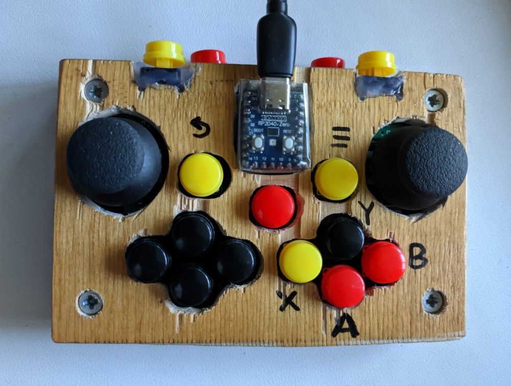

# gamepadPicoXbox360
Custom Xbox 360 gamepad emulation implementation for the RP2040 chip.

Note: 98% of the code was generated by AI.

## Description

A gamepad implementation based on the Raspberry Pi Pico's RP2040 chip. It uses the XInput protocol and aims for maximum compatibility with the Xbox 360 controller; most games detect and use it as such. If a game refuses to use the gamepad directly, Steam can be used to make it "100% compatible."

Unlike the original, this version includes "turbo" and "calibration" modes.

### Limitations

Since the RP2040 has only 4 ADC channels, only two analog sticks can be supported. The two analog triggers (L2/R2) are simulated using standard buttons; they mimic smooth travel to trick the system.

Naturally, there are no audio capabilities.

And, of course, there is no authenticity verification, so it is detected as a clone. However, this does not affect its operation on a PC.

### Features

This firmware does just one thing: it emulates an Xbox 360 controller. The code was primarily generated by AI; I simply provided direction and applied some final polish. The code is minimal yet functional.

It supports 17 buttons: two stick-click buttons and 15 separate buttons. This matches the count on the original Xbox controller. I used the RP2040-Zero, which offers only 16 accessible pins on the main header. I had to solder a connection to a pad on the back of the board, which is inconvenient. However, you can simply choose not to connect one of the stick-click buttons, as they are rarely used. The same applies to vibration feedback; it also connects via the underside of the board and is optional. Vibration is also mirrored by an LED on the microcontroller board.

The RP2040's ADC is 12-bit, whereas the gamepad is expected to output a 16-bit range. This causes some scaling and slightly affects the precision of the analog sticks. However, I didn't notice this while gaming. Since the sticks lack physical limiters, they trace a square path rather than a circle. While the values ​​are "rounded" via software, the sticks might not return perfectly to zero or reach their absolute maximum positions due to their physical placement; again, this isn't noticeable during gameplay.

The vibration motor pins are hardcoded, so they cannot be changed! They are shown in the configuration diagram solely to assist with assembly.

## Operation

The gamepad should work immediately upon connection. However, there are two additional modes:

- **Normal Mode:** Upon startup, the LED lights up white. Once the computer detects the gamepad and activates the driver, the LED changes color to indicate the player number. It turns green for Player 1 (followed by red, blue, and yellow for players 2, 3, and 4, respectively).

- **Calibration Mode:** If the "Center" button is held down while connecting the gamepad, it enters calibration mode, indicated by the LED flashing. First, the stick centers are determined over a two-second period; do not touch the sticks during this time. Next, the color changes, and you must move both sticks to their maximum extent to determine their actual range of motion. Afterward, the LED flashes again to confirm the settings have been saved. This procedure only needs to be performed once, or if the sticks start behaving erratically.

- **"Turbo" Mode:** While the gamepad is active, press and hold the "Back" and "Menu" buttons simultaneously. Then, while continuing to hold down at least one of these buttons, press the button you wish to set to "Turbo" mode. The LED will flash red, indicating that the button has been registered. You can set up to 6 buttons—A, B, X, Y, LB, and RB—for this feature. To cancel, repeat the same procedure; the LED will flash blue. The "Turbo" mode is reset whenever the controller is turned off.

## Assembly

### Software

PlatformIO handles everything once you open the project—it's the standard workflow. Alternatively, you can simply take the pre-compiled binary file and copy it to the RP2040 board. It’s a straightforward process:

- Press and hold the "boot" button.
- While holding "boot," briefly press "reset."
- Keep holding "boot" until the drive appears on your system.
- Release "boot" and copy the `APPLICATION.uf2` file to the newly appeared drive. Once the copy is complete, the board will reboot, and an "Xbox 360 Controller" will appear in your system.

### Hardware

I kept costs as low as possible, yet the total price still ended up being comparable to the cheapest gamepads available from China. My design aimed to make swapping buttons and sticks as simple as possible—especially the sticks: instead of a complex desoldering process, you simply replace the module.

The following components are listed as examples:

- base: ["7x9 cm single-sided FR4 prototyping board"](https://ledplus.com.ua/ua/p1061715049-maketnaya-plata-7h9.html)
- controller: [RP2040-Zero](https://radiostore.com.ua/ua/p2643717041-plata-razrabotchika-rp2040.html)
- buttons (15 units): [12x12 tactile button](https://ledplus.com.ua/ua/p1098946409-taktilnaya-knopka-12h12.html)
- separate caps (5 of each color): [Cap for 12x12 button](https://ledplus.com.ua/ua/p1099037998-klavisha-dlya-knopki.html)
- two joysticks: [Analog joystick](https://ledplus.com.ua/ua/p52160787-dzhojstik-analogovyj.html)
- wire, solder, rosin, and various mounting headers (as desired).

### PIN assignments

You can change pin assignments and other parameters in the `include/config.h` file when assembling the device yourself.

```C
/ WS2812 RGB LED (RP2040-Zero onboard NeoPixel)
#define PIN_RGB_LED         16

// Rumble Motor PWM Output. Don`t change! Не міняти!
#define PIN_MOTOR_LEFT  17
#define PIN_MOTOR_RIGHT 18

// Мапінг кнопок на GPIO піни RP2040-Zero (крім зайнятих RGB=16 та ADC=26-29)
#define PIN_BTN_A      8
#define PIN_BTN_B      7
#define PIN_BTN_X      9
#define PIN_BTN_Y      6

#define PIN_BTN_LB     2
#define PIN_BTN_RB     3

#define PIN_BTN_BACK   15
#define PIN_BTN_START  5
#define PIN_BTN_GUIDE  10  // Central

#define PIN_BTN_LS     19
#define PIN_BTN_RS     4

#define PIN_DPAD_UP    14
#define PIN_DPAD_DOWN  12
#define PIN_DPAD_LEFT  13
#define PIN_DPAD_RIGHT 11

#define PIN_BTN_LT     0
#define PIN_BTN_RT     1

// Analog Stick ADC Pins
#define ADC_STICK_LX        0 // GP26  // ADC0
#define ADC_STICK_LY        1 // GP27  // ADC1
#define ADC_STICK_RX        3 // GP29  // ADC3
#define ADC_STICK_RY        2 // GP28  // ADC2
```

## Описание на русском

Внимание. 98% кода сгенерировано ИИ.

## Описание

Реализация геймпада на чипе rp2040 RaspberryPi Pico. Используется протокол Xinput и максимально, насколько это возможно, совместимость с Xbox 360. Большинство игр его так и определяют и используют. Если игра не хочет пользоваться геймпадом напрямую, то помогает Steam, который окончательно превращает этот геймпад в "100% совместимый".

В отличии от оригинала имеется режим "турбо" и "калибровка".

### Ограничения

Так-как rp2040 имеет только 4 АЦП, то можно задействовать только два стика. Ещё остаются два аналоговых курка (L2/R2), они имитируются обычными кнопками и имеют имитацию плавного хода, таким образом обманывая систему.

Естественно, что нет аудио возможностей.

И конечно-же, нет подтверждения оригинальности, из-за чего определяется как клон. Впрочем это на работу с компьютером не влияет.

### Особенности

Эта прошивка делает только одно - имитирует работу Xbox360 controller. Код преимущественно сгенерирован ИИ и я лишь задавал направление и немного полировал на финишном этапе. Код минимально достаточный.

Используются 17 клавиш. Это две клавиши в стиках и 15 отдельных. Это столько, сколько в оригинальном Xbox. Я использовал rp2040-zero, где на основной гребёнке доступно только 16 клавиш. Я припаялся к контактной площадке с обратной стороны платы. Это неудобно. Впрочем, можно просто не подключать одну из кнопок в стиках, они редко используются. Это же относится и к виброотдаче. Она тоже подключается с нижней стороны. И её тоже можно не подключать. Виброотдача дублируется светодиодом на плате микроконтроллера.

АЦП в rp2040 12 бит, а геймпад должен отдавать 16 бит диапазон. Из-за этого происходит масштабирование и немного нарушается точность работы стиков. Но в играх я этого не ощущал. Если стики не имеют физического ограничителя, то они вместо окружности рисуют квадрат. У меня програмно "округляется" значения, но из-за положение стиков могут не идеально приходить в ноль или в крайнее положение. Но в играх это не ощущается.

Пины виброотдачи жестко привязаны в коде. По этому их менять нельзя! В конфигурации они показаны для облегчения сборки.

## Описание работы

Геймпад должен работать сразу при подключении. Но есть два дополнительных режима.

- **Нормальный режим**. При включении светодиод загорается белым. Если компьютер определил геймпад и активировал драйвер, то цвет измениться на цвет номера игрока. Если геймпад один, то будет зелёный. (дальше - красный, синий, желтый. Всего 4 игрока)

- **Калибровка**. Если при подключении нажата клавиша "Center", то геймпад перейдёт в режим калибровка, о чем поморгает светодиод. Сначала две секунды определяются центры стиков. В это время их трогать нельзя. Затем цвет изменится и надо максимально отклонять оба стика, чтобы определить реальный диапазон. После этого светодиод ещё раз поморгает и сохранит настройку. Процедуру надо проводить только один раз или если со стиками начали происходить странности.

- **Режим "Turbo"**. Во время работы надо одновременно нажать "Back" и "Menu". После этого, не отпуская хотя бы одну из этих клавиши, нажать ту клавишу, которую надо ускорить. Светодиод моргнёт красным, значит клавиша запомнена. Так можно ускорить 6 клавиш - A, B, X, Y, LB, RB. Для отмены надо повторить процедуру, при этом светодиод моргнёт синим. При выключении геймпада режим "Turbo" сбрасывается.

## Сборка

### Программная часть

Всё, что нужно сделает PlatformIO, когда Вы откроете проект. Всё как обычно. Или можно взять готовый бинарный файл и просто скопировать его на плату rp2040. Всё как всегда.

- Нажали клавишу "boot"
- Не отпуская "boot", нажимаете кратковременно "reset"
- Не отпуская "boot", ждёте когда подключится диск
- Отпускаете "boot", копируете файл APPLICATION.uf2 на этот, открывшийся диск. После окончания копирования плата перезагрузится и в системе появится "Xbox 360 Controller"

Изменить назначение PIN и другие параметры можно при самостоятельно сборке в файле include/config.h

### Аппаратная часть

Я делал всё максимально бюджетно, но даже так цена получилась сопоставимой с самым дешевым геймпадом из Китая. Мой расчёт был на то, чтобы можно было максимально просто менять кнопки и стики. Особенно стики, вместо сложной процедуры выпаивания просто меняется модуль.

Компоненты приведены как пример:

- основа: ["Макетна плата 7х9 см одностороння FR4"](https://ledplus.com.ua/ua/p1061715049-maketnaya-plata-7h9.html)
- контроллер: [RP2040-Zero](https://radiostore.com.ua/ua/p2643717041-plata-razrabotchika-rp2040.html)
- кнопки, 15 штук: [Тактильна кнопка 12х12](https://ledplus.com.ua/ua/p1098946409-taktilnaya-knopka-12h12.html)
- отдельно колпачки, по 5 каждого цвета: [Клавіша для кнопки 12х12](https://ledplus.com.ua/ua/p1099037998-klavisha-dlya-knopki.html)
- два джойстика: [Аналоговий Джойстик](https://ledplus.com.ua/ua/p52160787-dzhojstik-analogovyj.html)
- провод, припой, канифоль и различные гребёнки для монтажа, по вкусу.

## Photo

У меня всё выглядит так ужасно, но работает :) Нестандартное расположение клавиш продиктовано маленьким размером макетной платы. Впрочем, я бы не сказал, что играть менее удобно, чем на оригинальном Sony DualSense, за счёт компактного размера. И совместимость с играми лучше, так-как большинство игр для PC ориентированы именно под Xbox. Но я не спорю, оригинальные геймпады лучше :)


